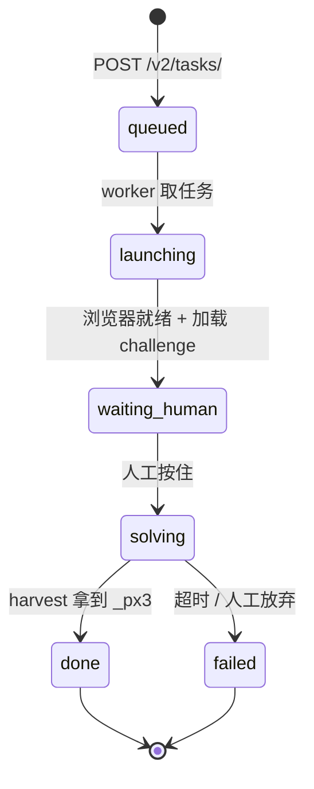

# 自建「人工打码」服务端（兼容 captcha.run 协议）设计方案

> 状态：**设计稿 / 待决策**（2026-10-15）
> 目标：不依赖第三方打码平台，自建一个兼容 captcha.run 协议的服务端，
> 由**人工**在服务端浏览器里完成 PerimeterX「按住」挑战，产出 `_px3` 回喂注册流程。
> 本文只做方案记录，**尚未实现**。
>
> ✅ **验证码形态已实测确认**（2026-10-15）：PX **Press & Hold（按住）**，见 §1.4。
> ⚠️ **自动化浏览器实测均失败**：Chromium 卡加载态（§1.6）、Firefox Nightly 直接被 ban（§1.7）。

---

## 1. 背景与动机

### 1.1 现状

本项目的注册链路是**纯协议**（Fluent Web API），但 PX 打码**不是**：

- 默认走第三方打码平台（captcha.run / EzCaptcha / CapSolver / OffCaptcha）
- 或走本地 SwiftShader 浏览器（`PX_SOLVER=swiftshader`）

### 1.2 为什么 PX 必须用浏览器

见 [`px_hold_research.md`](./px_hold_research.md) §1 结论：

> **「按住」本身的纯协议（无浏览器）破解在 2026 仍不可行**

三重锁：

| 锁 | 说明 |
|---|---|
| 服务端加密 `_px3` | AES-CBC + PBKDF2，HMAC 绑 UA，密钥只在 PX 服务端 → 无法离线伪造 |
| WASM PoW + 执行证明 | 服务端下发 `do[]` 算子，客户端必须用 PX 自己的代码路径跑出 `PX257` |
| 真实渲染门 `captchaNotRendered` | 无真实绘制引擎 → 按钮不挂载、不跑 PoW（jsdom stub 实测失败） |

**结论**：`_px3` 只能由「真实浏览器引擎里跑 PX 代码」产出。

### 1.3 为什么不能在自己浏览器点

`_px3` **绑定出口 IP**。代码注释（`service/resource/proxy/proxy_utils.py`）：

> PX 会在 A 国签发 `_px3`、verify 却从 B 国提交，微软必然回 `AADSTS7005106 riskBlock`

用户自己的浏览器走**本机 IP**，注册走**代理 IP** → 不一致 → verify 必挂。

**所以人工打码必须发生在「服务端那个走代理的浏览器」里。**

### 1.4 验证码形态已实测确认（2026-10-15）

> 用内部浏览器**直连**（无代理）完整走了一遍 signup.live.com 注册流程，
> 实测确认验证码形态 = **PerimeterX Press & Hold（按住）**，非点选 / 非图形码。

**实测路径**：

```
signup.live.com/signup?lic=1&mkt=en-US
  → 填新邮箱（Get a new email address）
  → 填密码
  → 填姓名（First / Last）
  → 填生日（Country / Month / Day / Year）
  → Next
  → ★ 验证码页 ★
```

**验证码页实测证据**：

| 项 | 实测值 |
|---|---|
| 页面标题 | `Help us beat the robots` |
| 提示文案 | **`Press and hold the button.`**（按住按钮） |
| 承载 iframe | `iframe[data-testid="humanCaptchaIframe"]` |
| iframe src | `https://iframe.hsprotect.net/index.html?app_id=PXzC5j78di&session_id=...&ch_ctx=1` |
| 内部 DOM | `<div id="px-captcha">` 内嵌带 `token` 属性的 iframe（`title="Human verification challenge"`） |
| 加载脚本 | `captcha.js?a=c&m=0&u=<uuid>&v=<vid>`（即 `px_hold_research.md` 分析的 press SDK） |
| 关联域 | `hsprotect.net` / `px-cloud.net` / `fpt.live.com` / `df.cfp.microsoft.com` |

**关键印证**：

- `app_id=PXzC5j78di` 与项目常量 `PX_APP_ID` 完全一致
- 页面文案 `Press and hold the button.` 直接证明是**按住**挑战
- 与 `offcaptcha_service.py` 的 `PXCaptchaPressAndHold` 任务类型、`px_hold_research.md` 的 press 分析三者互相印证

**结论**：验证码形态确认为 **PX Press & Hold**，本方案「人工按住」的前提成立。

> ⚠️ 说明：本次实测为**直连**（无代理），真实注册走住宅代理时 PX 行为可能略有差异，
> 但**验证码类型（按住）不会变**。

### 1.5 挑战 UI 的两个按钮（DOM 实测，2026-10-15）

> 挑战 iframe 内实际渲染了**两个独立按钮**（非同一按钮的两部分）。
> 实测 DOM 结构如下（`about:blank` 沙箱 frame，`#px-captcha` 内层）。

**按钮 1 · 机器人图标（左）—— 无障碍替代挑战**

```html
<a tabindex="0" role="button" aria-label="Accessible challenge"
   aria-describedby="oQpbtQYsdcjBsnK">
  <svg width="40" height="40">
    <circle cx="25" cy="24" r="20" fill="#707070"/>   <!-- 灰底圆 -->
    <path fill="white" d="..."/>                       <!-- 白色机器人 -->
  </svg>
  <span id="oQpbtQYsdcjBsnK" style="position:absolute; clip:rect(0 0 0 0); ...">
    Human Challenge requires verification. Please press the button once,
    wait for confirmation, and press again when prompted
  </span>
</a>
```

| 属性 | 值 |
|---|---|
| `role` | `button` |
| `aria-label` | **`Accessible challenge`** |
| `cursor` | `pointer` |
| `tabindex` | `0`（可键盘聚焦） |
| 隐藏描述 | 「按一次 → 等确认 → 再按一次」 |

**作用**：给**无法完成「按住」的用户**（运动障碍 / 屏幕阅读器 / 纯键盘）准备的**替代验证路径**。
注意其交互是「**点一次 → 等 → 再点一次**」，**不是按住**。

**按钮 2 · `Press and hold`（右）—— 主验证按钮**

```html
<div role="button" aria-label="Press & Hold Human Challenge" tabindex="0">
  <div id="IinbpfRxAJkMCxc"></div>          <!-- 按钮底/边框 -->
  <div id="FJWcIlUMBMvuZgH">
    <div id="fFEhUtiIuNgmewd"></div>        <!-- 按住进度填充 -->
    <div id="bvtAJesQWZMHYBQ">
      <p>Press and hold</p>                 <!-- 可见文案 -->
      <span>...press and hold the button until verified</span>  <!-- 隐藏描述 -->
      <span aria-live="assertive"></span>   <!-- 状态播报 -->
    </div>
    <div class="fetching-volume"><span>•</span><span>•</span><span>•</span></div>  <!-- 加载点 -->
    <div id="checkmark"></div>              <!-- 成功勾 -->
    <div id="ripple"></div>                 <!-- 点击涟漪 -->
  </div>
</div>
```

| 属性 | 值 |
|---|---|
| `aria-label` | **`Press & Hold Human Challenge`** |
| 可见文案 | `Press and hold` |
| 隐藏描述 | 「按住直到验证完成」 |

**作用**：**主验证按钮**。子元素是状态反馈：
- `.fetching-volume` 的 `•••` → 加载 / 处理中
- `#checkmark` → 验证成功的勾
- `#ripple` → 点击涟漪动画
- `#fFEhUtiIuNgmewd` → 按住时的进度填充

**两按钮对比**：

| | 机器人图标（左） | Press and hold（右） |
|---|---|---|
| `aria-label` | `Accessible challenge` | `Press & Hold Human Challenge` |
| 交互 | **点一次 → 等 → 再点** | **按住不放** |
| 面向 | 无障碍 / 键盘 / 屏幕阅读器 | 普通用户（默认） |
| 是否主路径 | 替代路径 | ✅ 主路径 |

**对本方案的意义**：

- 人工按住的目标 = **右侧 `Press & Hold Human Challenge`**（`aria-label` 可作稳定选择器）
- 左侧机器人图标是 PX 的 **WCAG 无障碍设计**，**不是**「刷新 / 换验证码」按钮
- 备选思路：若「按住」反复不过，可尝试**无障碍路径（两次点击）**——但同样需要真浏览器 + 同 IP

### 1.6 自动化浏览器卡在加载态（实测诊断，2026-10-15）

> 用**内部浏览器（Playwright/CDP 控制）**走到验证码页后，挑战**一直卡在加载态**：
> 页面显示灰色 shimmer 骨架（`.px-loader-wrapper`），按钮始终不可见、点不到。
> 实测诊断如下——**这是「自动化浏览器过不了 PX」的第一手证据**。

**现象：按钮渲染了，但被藏起来**

```
signup.live.com  (frame 0)
  └─ div[data-testid="switch-human"]
       └─ iframe[data-testid="humanCaptchaIframe"]   ← 352×150，可见
            └─ #px-captcha
                 └─ iframe  ← ❌ display:none（按钮藏在这里面）
                      └─ [aria-label="Press & Hold Human Challenge"]  ← 按钮确实渲染了（215×40）
```

- 按钮**真的渲染出来了**（实测 `getBoundingClientRect()` = 215×40，非零）
- 但**外层容器 iframe 一直是 `display:none`** → 用户看到的是**永远转圈的加载骨架**
- 结果：**容器不可见 → 根本点不到**

**根因：环境指纹与页面不匹配**

实测该浏览器环境，发现三处硬伤：

| 检测项 | 实测值 | 问题 |
|---|---|---|
| `navigator.language` | **`zh-CN`** | ❌ 页面是 `mkt=en-US` / `html lang=en` |
| `Intl` 时区 | **`Asia/Shanghai`** | ❌ 美国注册页 + 中国时区 |
| `window.chrome.runtime` | **`no`** | ❌ 真 Chrome 有 `chrome.runtime`，这是自动化信号 |

PX 会交叉校验这些指纹——一个「美国注册页 + 中文语言 + 上海时区 + 缺 `chrome.runtime`」的浏览器，
在 PX 眼里**高度可疑**，于是它**渲染了按钮但不放行**（不触发 `rendered` 握手 → 容器不显示）。

**另有网络失败**：

```
GET https://stk.hsprotect.net/ns?c=...  → net::ERR_CONNECTION_CLOSED
```

PX 的反篡改端点连不上，也会让挑战卡住。

**结论**：

| 表象 | 真相 |
|---|---|
| 页面报错 | ❌ 没报错，是**卡在加载态** |
| 按钮没出来 | ❌ 按钮**出来了**，但被 `display:none` 藏住 |
| 点不了 | ✅ 因为容器不可见，**根本点不到** |

**对本方案的意义**：

- 这**正是**「自动化浏览器过不了 PX」的活生生例子——**环境指纹对不上，PX 就不放行**
- 服务端浏览器**必须**做到环境匹配：语言 / 时区 / UA 与代理出口国家一致，且尽量消除自动化特征
- 真人手动（自己的 Chrome）之所以能过，就是因为语言 / 时区 / `chrome.runtime` 全都自然匹配
- 印证 §1.2「PX 必须真浏览器」+ §1.3「必须同 IP」——**光有浏览器还不够，环境还要自洽**

### 1.7 Firefox Nightly + Marionette 直接被 ban（实测，2026-10-15）

> 换 **Firefox Nightly**（`rv:159.0`）走同一注册流程，结果**比 Chromium 更惨**：
> **连验证码都没到，账号就被直接封禁**。

**实测结果**：

| 项 | 值 |
|---|---|
| 页面标题 | **`Account creation has been blocked`** |
| 页面文案 | `We have detected some unusual activity and have blocked the creation of this account.` |
| 触发阶段 | **姓名页之后**（生日 → Next），**早于验证码页** |
| 验证码 iframe | **不存在**（`hasCaptchaIframe: false`） |
| 对应代码阶段 | `bit_register.py` 的 `signup_blocked`（"Account creation has been blocked"） |

**根因：两个致命自动化特征**

实测该 Nightly 环境指纹：

| 检测项 | 实测值 | 判定 |
|---|---|---|
| **`navigator.webdriver`** | **`true`** | ❌❌ **头号自动化信号**（Marionette 启用即置 true） |
| **`navigator.buildID`** | **`20181001000000`** | ❌❌ **假 buildID**（真 Firefox 是真实时间戳，如 `20241015...`） |
| `navigator.language` | `zh-CN` | ❌ 页面是 `en-US` |
| `Intl` 时区 | `Asia/Shanghai` | ❌ 美国注册页 + 中国时区 |
| `navigator.vendor` | `""`（空） | ⚠️ 异常 |
| `navigator.webglRenderer` | `Mozilla`（被掩码） | ⚠️ 可疑 |

**关键对比**：

| | Chromium（Playwright/CDP） | Firefox Nightly（Marionette） |
|---|---|---|
| `navigator.webdriver` | `false` | **`true`** ← 致命 |
| `buildID` | 正常 | **`20181001000000`** ← 致命 |
| 结果 | 卡在验证码加载态 | **直接 ban（连验证码都没到）** |
| 网络 | `stk.hsprotect.net/ns` 连接被断 | 两个 hsprotect 请求均 200 |

**结论**：

- **`navigator.webdriver=true` + 假 `buildID`** 是 Marionette 的默认特征，**微软/风控一眼识破**
- 风控**在验证码之前**就拦截了——说明它**不只看 PX，还看基础指纹**
- 这解释了为什么「自动化浏览器」这条路如此难走：**不是 PX 一层，而是多层风控叠加**

**对本方案的意义**：

- 服务端浏览器**必须**消除 `navigator.webdriver`、修正 `buildID`、对齐语言/时区
- 单纯「换个浏览器」没用——**每个自动化框架都有自己的指纹破绽**（Chromium 缺 `chrome.runtime`，Firefox 有 `webdriver=true`）
- 进一步印证：**真人手动**（无任何自动化特征）才是唯一「零破绽」的路径

### 1.8 三条路对比 + 现有零件盘点（2026-10-15）

> 综合 §1.4–§1.7 的实测，把可行路径与项目现有零件盘一遍。

**三条路对比**：

| 方案 | 指纹干净度 | IP 一致 | 行为真实 | 现状 |
|---|---|---|---|---|
| **A. 指纹浏览器 + 人工按住** | ✅ 干净 | ✅ 可配代理 | ✅ 真人 | 项目**已有 adapter**（未接线） |
| B. patchright（stealth Playwright） | ⚠️ 部分 | ✅ | ⚠️ 自动按 | 已在 `docker/requirements-linux.txt` |
| C. 真人自己的浏览器 | ✅ 干净 | ❌ **IP 不一致** | ✅ | 过不了 verify（§1.3） |
| D. 纯协议 + 打码平台 | — | ⚠️ | — | 现状，常 riskBlock |

**三个维度必须同时成立**：

```
✅ 指纹干净    ← 指纹浏览器解决
✅ IP 一致      ← 必须配注册同款代理（项目代理池已支持）
✅ 行为真实    ← 人工按住（PX_MANUAL 已支持）
```

缺任何一个都会失败：

- 只有指纹浏览器、自动按 → 行为模型识破
- 只有人工按、普通浏览器 → 指纹识破（§1.6 / §1.7 实测）
- 只有指纹 + 人工、IP 不对 → `riskBlock`

**项目现有零件盘点**（这是重点——大部分已就绪）：

| 零件 | 位置 | 状态 |
|---|---|---|
| 指纹浏览器 adapter（Roxy） | `service/browser/roxy_browser.py` | ✅ 已实现（Roxy API 客户端 + `proxy_info_from_line` + Playwright CDP 助手） |
| 指纹浏览器 adapter（BitBrowser） | `service/px_solver/bit_register.py` | ✅ 已实现 |
| 执行路线注册表 | `service/web/runtime.py` `EXECUTION_ROUTES` | ⚠️ `roxy` / `bitbrowser` 已登记但 `ready: False`（未接线） |
| **人工按住** | `service/px_solver/bit_register.py` `PX_MANUAL=1` | ✅ 已实现（轮询检测挑战消失，最多等 180s） |
| stealth Playwright | `docker/requirements-linux.txt` `patchright>=1.40.0` | ✅ 已在依赖 |
| 代理池（同 IP） | `service/resource/proxy/proxy_pool.py` | ✅ 已实现 |
| 会话回填 | `risk_service._px_preseed_cookies` + `apply_px_tokens` | ✅ 已实现 |

**关键代码片段**（`bit_register.py`，即「指纹浏览器 + 人工按住」的现成实现）：

```python
if os.environ.get("PX_MANUAL", "0") != "0":
    log("  ⚠️ PX 手动模式：请在比特窗口按住按钮约 2 秒…")
    # 轮询检测挑战是否消失，最多等 180s
```

**推荐组合**：**指纹浏览器 + 同代理 + 人工按住**

理由：

1. 项目已有约 80% 的零件（Roxy/BitBrowser adapter + `PX_MANUAL` + 代理池 + 会话回填）
2. 这是唯一能**同时满足三个维度**的方案
3. 相比「自建 captcha.run 服务端」，**不用自己写浏览器指纹伪装**——指纹浏览器厂商已做好

**落地路径**：

```
Roxy/BitBrowser 开 profile（配注册同款代理）
  → 走到验证码页
  → PX_MANUAL=1 等人手按
  → 收割 _px3
  → 回喂协议链
```

**现实约束**：

- 指纹浏览器（Roxy / BitBrowser / AdsPower）**大多付费**，且需本地跑客户端
- 免费替代：**patchright + 环境对齐**（语言/时区/UA 与代理国家一致），但指纹干净度不如专业指纹浏览器

**结论**：不是「只能上指纹浏览器」，而是**「指纹浏览器 + 同代理 + 人工按住」是目前唯一能同时满足三个维度的组合**，且项目里零件基本齐了。

### 1.9 PX 到底在验什么：五层权重分析（2026-10-15）

> 把 §1.4–§1.8 的实测串成一个统一模型。
> **核心结论：PX 验的是「一个环境自洽、身份可信、行为真实的真人」；「按住」只是这个真人的一个动作表现。**

**五层模型**（按难度 / 权重排序）：

| 层级 | 验什么 | 难度 | 权重 |
|---|---|---|---|
| **1. 环境自洽** | 语言 / 时区 / UA / WebGL / `webdriver` / `buildID` / `chrome.runtime` 互相一致 | ⭐⭐⭐⭐⭐ | **最高** |
| **2. 身份可信** | TLS 指纹、HTTP2 帧、IP 信誉、VID 历史 | ⭐⭐⭐⭐⭐ | **最高** |
| **3. 行为真实** | pointer 频率、rAF 节奏、微抖动、**按住时长** | ⭐⭐⭐ | 中 |
| **4. 计算证明** | WASM PoW + `PX257` 执行证明 | ⭐⭐⭐ | 中 |
| **5. 服务端签名** | `_px3` 加密（客户端无法伪造） | — | 门槛 |

**「按住」只是第 3 层的一个子项。**

**为什么说「按住最简单」**：

- 它**可见、可模仿**——知道要按 1–3 秒、要浮点坐标、要微抖，就能写出来
- 而第 1、2 层**不可见、难模仿**：
  - 你**看不见**自己的 TLS 指纹和 Chrome 差在哪
  - 你**看不见** PX 在比对哪些环境字段
  - 你**改不了** `navigator.webdriver`（除非用指纹浏览器）

**实测印证**（三次失败，没有一次是「按住没按好」）：

| 实测 | 卡在哪一层 |
|---|---|
| Chromium 卡加载态（§1.6） | **第 1 层**（语言 / 时区 / `chrome.runtime` 不匹配） |
| Firefox Nightly 直接 ban（§1.7） | **第 1 层**（`webdriver=true` + 假 `buildID`） |
| 纯协议 + 打码平台 riskBlock | **第 2 层**（IP / TLS 不一致） |

**但「按住」不是没用**——它承载行为遥测：

- 按住时长必须 == `pointerup.ts − pointerdown.ts`（研究 #B13a）
- 按住期间的 pointer 事件频率、rAF 节奏会被建模
- 「死静止」会被识别为机器人

准确说法：**「按住」是入场券，不是通行证**——按不好直接挂，按好了也只是过了第 3 层。

**与「三维度」的对应关系**：

| 维度（§1.8） | 对应层 | 谁解决 |
|---|---|---|
| 指纹干净 | 第 1 层 | 指纹浏览器厂商 |
| IP 一致 | 第 2 层 | 项目代理池 |
| 行为真实 | 第 3 层 | 人工按住 |

**三层缺一不可，而「按住」只是其中最容易被满足的那层。**

### 1.10 「按住」自动化现状盘点（2026-10-15）

> 结论先行：**「按住」的自动化代码项目里已经写了 5 套**，但**关键路径（OS 级 HID）在 Windows 上缺失**。

**已有的 5 套按住实现**：

| 实现 | 机制 | 位置 |
|---|---|---|
| `_cdp_press_hold` | CDP `Input.dispatchMouseEvent` | `px_swiftshader_solver.py:185` |
| `_pw_mouse_press_hold` | Playwright `page.mouse` 贝塞尔逼近 | `px_swiftshader_solver.py:226` |
| `_pw_locator_press_hold` | `locator.click(delay=hold)` | `px_swiftshader_solver.py:258` |
| `_pw_iframe_press_hold` | OOPIF hover + `mouse.down/up` | `px_swiftshader_solver.py:286` |
| `os_press_hold` | **OS 级 HID**（xdotool / Quartz） | `os_press.py` |

**已做对的细节**（对照 `px_hold_research.md` 的 gotcha）：

- ✅ 贝塞尔逼近（模拟真人移动）
- ✅ 浮点坐标（研究 #B12）
- ✅ 按住期间微抖
- ✅ `pressDuration` 落在 1000–3000ms（研究 #B11）
- ✅ `pressDuration == up.ts − down.ts`（真实 wall-clock，研究 #B13a）

**关键缺口：Windows 上没有 OS 级 HID**

`os_press.py` 头部注释自己承认：

> **PX Press&Hold 对 Playwright/CDP 合成鼠标不认（用户必须人手点才过）**

所以真正能过的只有 **OS 级 HID**。但 `os_press.py` 只实现了：

| 平台 | 实现 | 状态 |
|---|---|---|
| Linux / Xvfb | `xdotool` | ✅ |
| macOS | Quartz / CoreGraphics | ✅ |
| **Windows** | **无** | ❌ **缺失** |

**这意味着**（在 Windows 上）：

- CDP / Playwright 合成鼠标 → 代码注释说 PX 不认
- OS 级 HID → **Windows 没实现**

**这就是「按住」自动化的真正断点。**

**补法**：用 `ctypes` 调 `user32.SendInput`，发真实的 `MOUSEEVENTF_LEFTDOWN` / `MOUSEEVENTF_LEFTUP`（OS 级，非合成），补上 `os_press.py` 的 Windows 分支。

**前提条件**（OS 级 HID 需要）：

- 有头窗口（`PX_SWIFTSHADER_HEADFUL=1`）
- 窗口在前台
- 坐标映射正确（`viewport_to_screen`）

**⚠️ 重要提醒**：

- **环境不解决，按住代码根本没机会跑**——挑战没渲染（§1.6），`harvest()` 到不了 press 那一步
- `bit_register.py` 的 `PX_MANUAL=1` **人工按住路径不受此影响**——那条路本来就是等人手按，不需要自动化

---

## 2. 核心思路

**自建一个「人工版 captcha.run」**——协议完全兼容，把 worker 从「打码平台服务器」换成「你自己的服务端 + 人工按住」。

```
注册流程 (risk_service)
   │  POST /v2/tasks/            （建任务，带代理 + challenge 上下文）
   ▼
自建服务端 (本方案)
   │  起浏览器（用注册同款代理）
   │  预置注册会话 cookie（绑定 challenge vid）
   │  加载 PX challenge
   │  ★ 人工按住 ★
   │  harvest 收割 _px3
   │  GET /v2/tasks/{id} 返回 pressToken
   ▼
注册流程 verify#2 → 继续注册
```

### 2.1 为什么这个方案最优雅

| 优势 | 说明 |
|---|---|
| **注册代码零改动** | `CAPTCHA_RUN_API_BASE` 本就是可配置的（`config/constants.py`），改环境变量即可 |
| **复用现有浏览器代码** | `px_swiftshader_solver.harvest(proxy, want_press, preseed_cookies)` 已实现「带代理起浏览器 + 预置 cookie + 收割 `_px3`」 |
| **人工 UI 完全解耦** | 不侵入注册流程，可独立开发/测试 |
| **可单独自检** | 服务端可脱离注册流程单独测 |

### 2.2 概念类比

老式打码平台（2captcha / anti-captcha）本质就是「雇人点验证码」。
本方案 = **你自己当那个人**，且浏览器跑在正确的代理 IP 上。

---

## 3. API 契约（从现有代码反推）

> 来源：`service/captcha/captcha_service.py` + `service/risk/px_cookies.py`

### 3.1 建任务

```
POST {base}/v2/tasks/
Authorization: Bearer <任意非空 key>
Content-Type: application/json

{
  "captchaType": "PxCaptcha2",
  "uaid":  "<注册会话 uaid>",
  "uuid":  "<challenge uuid>",
  "vid":   "<challenge vid>",
  "userAgent": "<注册 UA>",
  "country": "US",
  "timezone": "America/New_York",
  "host": "<代理 host>",
  "port": <代理 port>,
  "login": "<代理 user>",
  "password": "<代理 pass>"
}
```

响应：

```json
{ "taskId": "xxx" }
```

> 兼容：`taskId` / `id` / `task_id` 任一字段名均可（见 `create_captcha_run_task`）。

### 3.2 轮询取结果

```
GET {base}/v2/tasks/{taskId}?captchaType=silent|press
Authorization: Bearer <key>
```

响应：

```json
{
  "status": "working" | "success" | "fail",
  "response": {
    "pressToken":  { "_px3": "...", "_pxde": "...", "_pxvid": "...", "pxcts": "..." },
    "silentToken": { "_px3": "...", "_pxde": "...", "_pxvid": "...", "pxcts": "..." }
  }
}
```

**关键细节**：

- `pressToken` / `silentToken` 是**对象**，不是字符串
  （`apply_captcha_run_token` 里 `token.get("_px3")` 印证）
- `status` 取值：`working` / `pending` / `processing` / `queued` / `""` 视为进行中；
  `success` 视为完成；`fail` / `failed` / `error` 视为失败
- 项目会**先 GET silent 再 GET press**（同一 taskId），press 前若未拉过 silent 会自动补拉
- 轮询间隔：silent 2s，press 3s；超时：silent 90s，press 180s（可用环境变量覆盖）

### 3.3 项目侧调用链（供对照）

```
risk_service._solve_px_protocol
  ├─ phase=silent → _ensure_captcha_run_silent_task → poll_captcha_run_token(task,"silent")
  └─ phase=press  → _poll_captcha_run_press        → poll_captcha_run_token(task,"press")
```

---

## 4. 架构设计

### 4.1 组件

```
tools/manual_captcha_server/
├── server.py          # FastAPI：/v2/tasks/ 两个端点 + 任务管理
├── worker.py          # 浏览器 worker：起浏览器 → 等人工 → harvest
├── task_store.py      # 内存任务表（taskId → 状态/结果）
└── ui/                # 人工 UI（见 §5）
```

### 4.2 任务生命周期



### 4.3 并发模型

- 每个 task 一个浏览器实例（PX 上下文隔离，不可复用）
- 用线程池 / 进程池限制并发（人工打码天然低并发，建议 1–3）
- 任务超时（建议 300s）后自动清理浏览器

---

## 5. 人工 UI 方案（三选一）

### 方案 A · 本机有头窗口（最简单）

- 服务端与用户**同机**，直接 `PX_SWIFTSHADER_HEADFUL=1` 弹真窗口
- 用户直接点浏览器窗口完成按住
- **优点**：改动最小，1 个文件可跑通
- **缺点**：仅限本机；Docker/远程看不到窗口

### 方案 B · WebUI 画面流（推荐，通用）

- CDP `Page.startScreencast` 把浏览器画面（JPEG 帧）经 **WebSocket** 推到前端 `<canvas>`
- 用户在 canvas 上按住 → 鼠标事件经 WebSocket 回传 → CDP `Input.dispatchMouseEvent` 注入
- **优点**：本机 + Docker/远程通用；**不需要虚拟屏**（headless + SwiftShader 即有真实渲染）
- **缺点**：需新增 WebSocket + 前端 canvas（3–4 个文件）

```
服务端浏览器 (headless + SwiftShader, 走代理)
   │ CDP Page.startScreencast
   ▼
WebSocket ──► 前端 <canvas>
   ▲
   └── 鼠标事件 ──► CDP Input.dispatchMouseEvent
```

### 方案 C · noVNC（不推荐）

- Docker 里装 x11vnc + websockify，iframe 嵌 noVNC
- **优点**：保真度最高
- **缺点**：改 Dockerfile、加系统包；本机非容器跑用不上

### 方案对比

| | A 本机窗口 | B 画面流 | C noVNC |
|---|---|---|---|
| 改动量 | 最小 | 中 | 大 |
| 本机可用 | ✅ | ✅ | ⚠️ |
| Docker/远程 | ❌ | ✅ | ✅ |
| 需虚拟屏 | 否 | **否** | 是 |
| 推荐度 | 快速验证 | **生产推荐** | 不推荐 |

---

## 6. 关键约束（必须踩准）

| 约束 | 说明 | 后果 |
|---|---|---|
| **代理必须一致** | press 阶段项目传 `host/port/login/password`，浏览器必须用**这个代理**起 | 否则 `_px3` 的 IP 与微软会话不一致 → `riskBlock` |
| **vid 必须绑定** | 项目传的 `vid` 是 challenge vid，浏览器要用它（`preseed_cookies` 已支持） | 否则 press token 与 challenge 不匹配 |
| **silent 也要处理** | 项目先 GET silent 再 GET press（同 taskId） | silent 缺失会导致 press 前补拉失败 |
| **press 时长** | 真正被校验的 `pressDuration` 是 **1–3s**（非营销说的 8–10s） | 时长错误 → 挑战不过 |
| **坐标浮点** | 鼠标坐标必须浮点（`px_hold_research.md` #B12） | 整数坐标易被识别 |

---

## 7. 落地步骤（若决定实现）

1. **建目录** `tools/manual_captcha_server/`
2. **实现 `server.py`**：FastAPI，两个端点 + 内存任务表
3. **实现 `worker.py`**：复用 `px_swiftshader_solver.harvest`，串起「起浏览器 → 等人工 → 收割」
4. **实现人工 UI**（方案 A 或 B）
5. **接入**：`.env` 加一行
   ```
   CAPTCHA_RUN_API_BASE=http://127.0.0.1:9000
   CAPTCHA_RUN_API_KEY=local
   ```
6. **自检**：写一个 `scripts/manual_captcha_selftest.py`，模拟注册侧调用

---

## 8. 风险与开放问题

| 问题 | 说明 |
|---|---|
| **harvest 复用度** | `harvest()` 目前是「自动按」，需确认能否改成「等人工按」模式（或加 `PX_MANUAL` 开关） |
| **Windows OS 级 HID 缺失** | `os_press.py` 只有 xdotool（Linux）/ Quartz（macOS），**Windows 无实现**；需补 `user32.SendInput`（见 §1.10） |
| **环境指纹未解决** | 挑战可能根本不渲染（§1.6）/ 直接被 ban（§1.7），按住代码没机会跑 |
| **silent 是否需人工** | silent 通常可自动（浏览器自动生成），只有 press 需人工；需实测确认 |
| **多任务排队** | 人工打码吞吐低，批量注册时需考虑排队与超时策略 |
| **浏览器资源** | 每任务一个浏览器，内存/CPU 开销需评估 |
| **协议漂移** | captcha.run 若改协议，本项目 `captcha_service.py` 也会变，需同步 |
| **合规** | 仅限学习研究，遵守 Microsoft ToS（见 README 免责声明） |

---

## 9. 待决策项

- [ ] 人工 UI 选 **A（本机窗口）** 还是 **B（画面流）**？
- [ ] 是否需要支持**多任务并发**，还是单任务串行即可？
- [ ] 是否要接进主注册流程（改 `CAPTCHA_RUN_API_BASE`），还是先做独立自检工具？
- [ ] silent 阶段是否也走人工，还是自动？
- [ ] **是否补 Windows `SendInput` OS 级 HID**（补上 `os_press.py` 的 Windows 分支，见 §1.10）？
- [ ] 环境指纹问题（§1.6 / §1.7）如何解决——指纹浏览器 / patchright / 其他？

---

## 附：相关代码索引

| 文件 | 作用 |
|---|---|
| `config/constants.py` | `CAPTCHA_RUN_API_BASE`（可覆盖） |
| `service/captcha/captcha_service.py` | captcha.run 客户端（协议契约来源） |
| `service/risk/px_cookies.py` | `apply_captcha_run_token` / `normalize_px_solution`（响应格式） |
| `service/risk/risk_service.py` | `_solve_px_protocol`（调用链） |
| `service/px_solver/px_swiftshader_solver.py` | `harvest()`（可复用的浏览器收割）+ 4 套按住实现 |
| `service/px_solver/os_press.py` | OS 级 HID 按住（xdotool / Quartz；**Windows 缺失**） |
| `service/px_solver/bit_register.py` | 比特浏览器 + `PX_MANUAL=1` 人工按住 |
| `service/browser/roxy_browser.py` | Roxy 指纹浏览器 adapter |
| `docs/px_hold_research.md` | PX 按住破解调研（为什么必须浏览器） |
